<p align="center">
  
</p>

<h1 align="center">Keeply</h1>

<p align="center"><strong>Satın aldıkların, garantilerin ve belgelerin tek yerde.</strong></p>

<p align="center">
  
  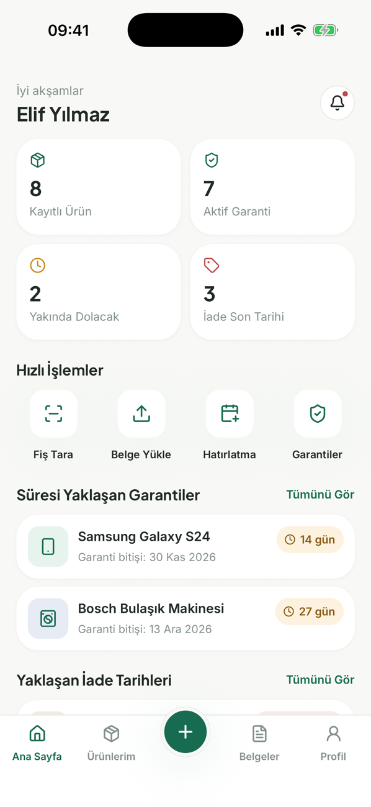
  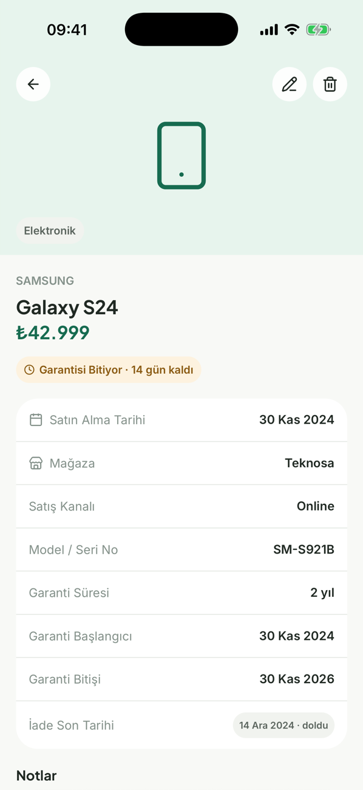
</p>

Keeply'ı, aldığım ürünlerin fişlerini, garanti belgelerini ve iade tarihlerini bir türlü düzenli tutamadığım için geliştirdim. Fişler cüzdanda siliniyor, garanti belgeleri çekmecede kayboluyor, iade süresi de çoğu zaman fark etmeden doluyordu. Bu uygulamayla ürünlerimi kaydediyor, belgelerimi telefonumda saklıyor, garanti ve iade süreleri yaklaştığında bildirim alıyorum.

## İçindekiler

- [Neden geliştirdim](#neden-geliştirdim)
- [Neler yapabiliyor](#neler-yapabiliyor)
- [Ekran görüntüleri](#ekran-görüntüleri)
- [Kullandığım teknolojiler](#kullandığım-teknolojiler)
- [Veri katmanı](#veri-katmanı)
- [Mimari](#mimari)
- [Klasör yapısı](#klasör-yapısı)
- [Kurulum](#kurulum)
- [Komutlar](#komutlar)
- [Ortam değişkenleri](#ortam-değişkenleri)
- [İstediğim izinler](#istediğim-izinler)
- [Testler](#testler)
- [Çalışma düzenim](#çalışma-düzenim)
- [Sırada ne var](#sırada-ne-var)
- [Lisans](#lisans)

## Neden geliştirdim

Bir ürünün garantisi ne zaman bitiyor, faturası nerede, iade hakkım hâlâ var mı... Bu soruların cevabını her seferinde aramak yerine tek bir yerde görmek istedim. Hedefim, gerçek bir mobil ürün gibi davranan, tamamen Türkçe ve ücretsiz araçlarla geliştirilmiş bir uygulama yapmaktı:

- Her ürünün mağazası, fiyatı, garanti süresi ve iade son tarihi kayıtlı.
- Garanti bitişi ve iade son tarihi otomatik hesaplanıyor, yaklaşınca hatırlatılıyor.
- Fiş, fatura, garanti belgesi ve sözleşmeler ilgili ürüne bağlı olarak saklanıyor.
- Servis ve tamir kayıtları ürünün geçmişinde tarih sırasıyla tutuluyor.

## Neler yapabiliyor

### Ürün yönetimi
- Ürünleri 6 adımda ekliyorum: görsel, ürün bilgisi, satın alma, garanti, fiş/fatura ve onay.
- Ürünleri düzenleyebiliyor ve silebiliyorum. Bir ürünü sildiğimde ona bağlı belgeler, servis kayıtları ve hatırlatmalar da siliniyor.
- Ürün görselini kamerayla çekiyor ya da galeriden seçiyorum.
- Kategoriler: Elektronik, Beyaz Eşya, Ev ve Yaşam, Moda, Kişisel Bakım, Mobilya, Diğer.
- Arama Türkçe karakterlere duyarsız çalışıyor; `bulasik` yazdığımda "Bulaşık Makinesi" geliyor.
- Kategoriye ve garanti durumuna göre süzüyor; son eklenene, ada, fiyata ve garanti bitişine göre sıralıyorum.
- Ürünleri liste ya da ızgara olarak görüntüleyebiliyorum.

### Garanti ve iade takibi
- Garanti bitişini takvim ayına göre hesaplıyorum (31 Ocak'ta başlayan 1 aylık garanti, şubatın son günü biter).
- Garanti durumları: Aktif, Yakında Dolacak (30 gün ve altı), Süresi Dolmuş, Garantisiz.
- Her garanti için kalan gün sayısını ve geçen süreyi gösteriyorum.
- İade son tarihi varsayılan olarak satın almadan 14 gün sonra; son 3 gün "Acil" olarak işaretleniyor.
- Tarihleri gün bazında hesapladığım için yaz saati ve saat dilimi geçişlerinden etkilenmiyor.

### Fiş tarama ve belgeler
- Fişi kamerayla çekip önizleyebiliyor, döndürebiliyor, tekrar çekebiliyor ya da galeriden seçebiliyorum.
- Kamera izni verilmezse ayarlara yönlendiriyor ve galeriden seçme seçeneği sunuyorum.
- PDF, JPG ve PNG belgeleri (en fazla 10 MB) fiş, fatura, garanti belgesi ya da sözleşme olarak saklıyorum.
- Belgeler sekmesinde arama, türe göre süzme, önizleme, paylaşma ve silme var.
- Belgeleri ilgili ürüne bağlayabiliyorum.
- Fişteki yazıları otomatik okuma (OCR) özelliği henüz yok. Bu yüzden arayüzde "Yakında" olarak gösteriyorum ve hiçbir zaman uydurma bir sonuç göstermiyorum.

### Servis geçmişi
- Her ürün için servis tarihi, servis sağlayıcı, sorun, yapılan işlem, ücret, not ve servis belgelerini kaydediyorum.
- Kayıtlar ürün başına zaman çizelgesi olarak listeleniyor, toplam servis ücreti de hesaplanıyor.

### Bildirimler ve hatırlatmalar
- Garanti bitişinden 7, 14 ya da 30 gün önce (hangilerini istediğimi seçiyorum) ve bitiş gününde telefona bildirim geliyor.
- İade son tarihinden 3 gün ve 1 gün önce bildirim geliyor.
- Kendi tarihli hatırlatmalarımı da oluşturabiliyorum.
- Bildirimler Bugün, Bu Hafta ve Daha Önce olarak gruplanıyor; okundu olarak işaretleyebiliyorum.
- Bildirim izni verilmezse uygulama "hatırlatma planlandı" demiyor, gerçek durumu gösteriyor.

### Ana sayfa
- Saate göre selamlama, kayıtlı ürün, aktif garanti, yakında dolacak garanti ve açık iade sayıları.
- Hızlı işlemler: Fiş Tara, Belge Yükle, Hatırlatma, Garantiler.
- Süresi yaklaşan garantiler, yaklaşan iade tarihleri, son eklenen ürünler ve son hareketler.

### Hesap ve ayarlar
- Kayıt olma, giriş yapma, şifre sıfırlama ve çıkış yapma. Oturum bilgisini cihazın güvenli alanında saklıyorum.
- Hesap bilgilerini ve şifreyi değiştirme.
- Açık, koyu ve sistem teması.
- Bildirim tercihleri, gizlilik ayarları, tüm verileri silme ve hesabı silme.
- Bütün verilerimi tek bir dosya olarak dışa aktarma.
- Yardım merkezi, destek bağlantısı ve hakkında sayfası.

## Ekran görüntüleri

Görüntüleri, iOS simülatöründe çalışan uygulamadan örnek verilerle aldım.

| Hoş geldin | Keeply ile neler yapılır | Giriş |
| --- | --- | --- |
|  | 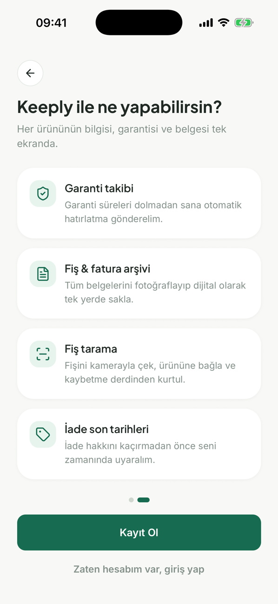 | 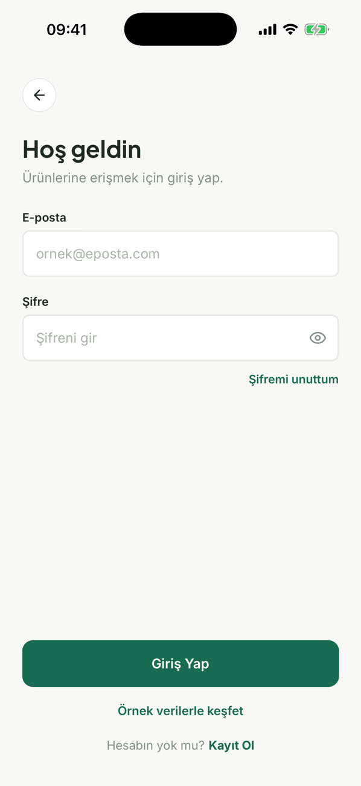 |

| Ana sayfa | Ürünlerim | Ürün detayı |
| --- | --- | --- |
|  | 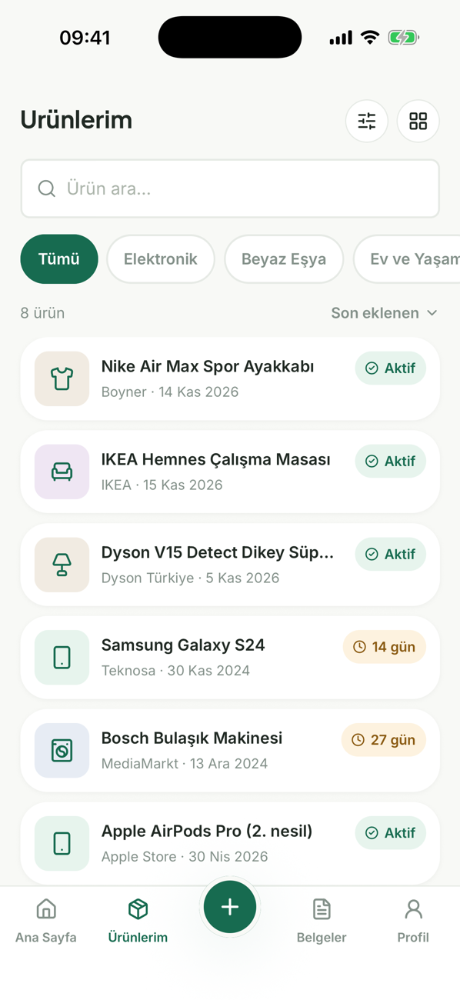 |  |

| Ürün ekleme | Fiş tarama | Garantiler |
| --- | --- | --- |
| 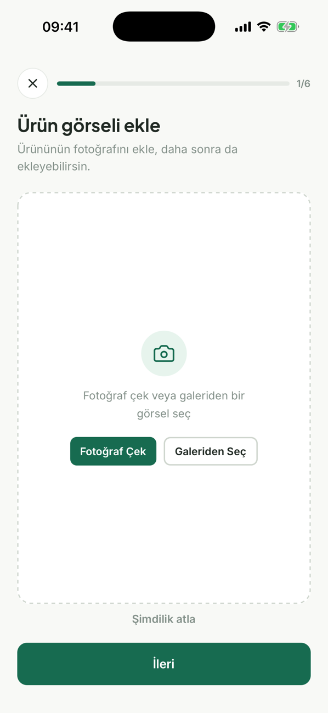 | 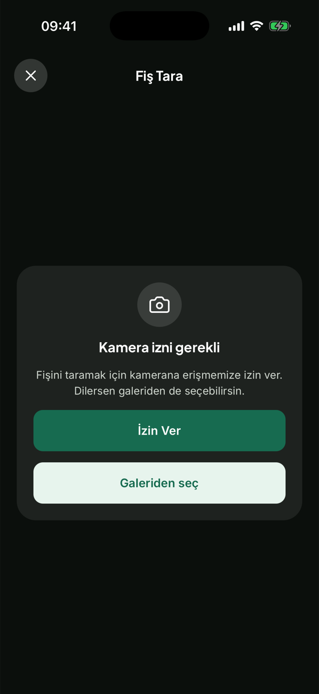 | 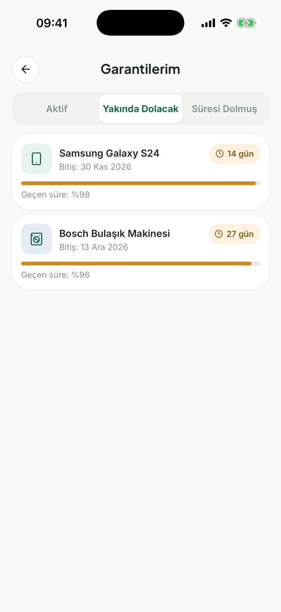 |

| İade süreleri | Belgeler | Servis geçmişi |
| --- | --- | --- |
| 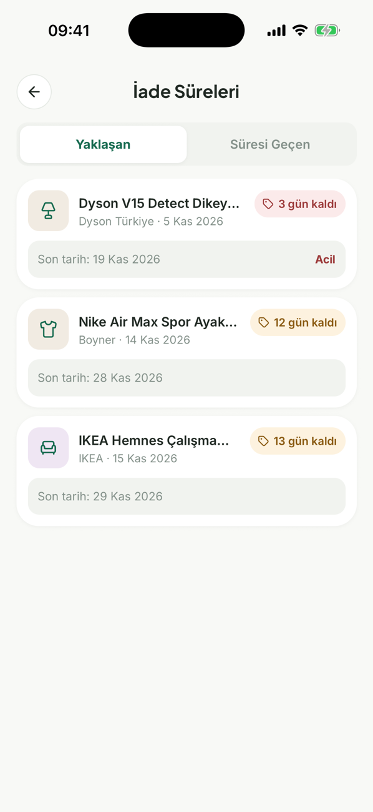 | 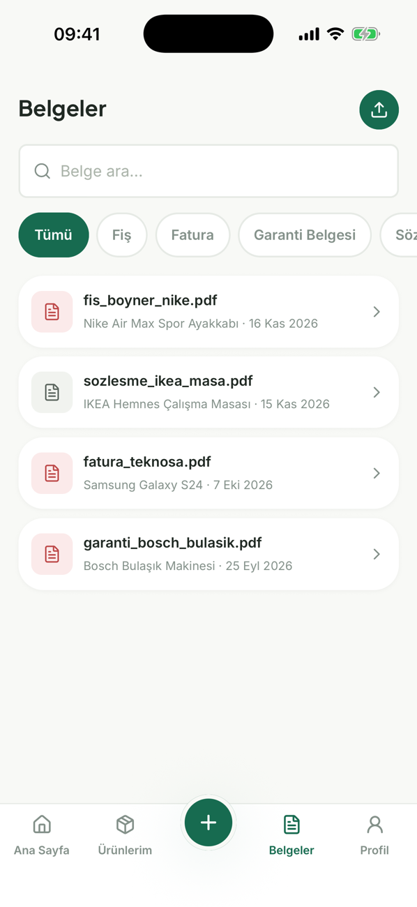 |  |

| Bildirimler | Bildirim tercihleri | Profil |
| --- | --- | --- |
| 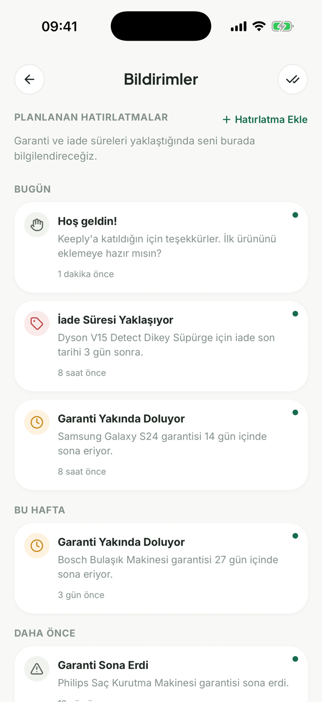 | 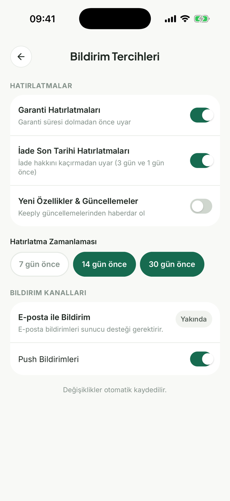 | 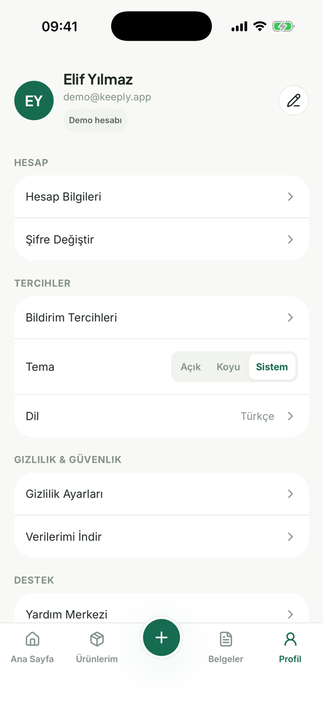 |

| Koyu tema: Ana sayfa | Koyu tema: Ürünlerim |
| --- | --- |
|  | 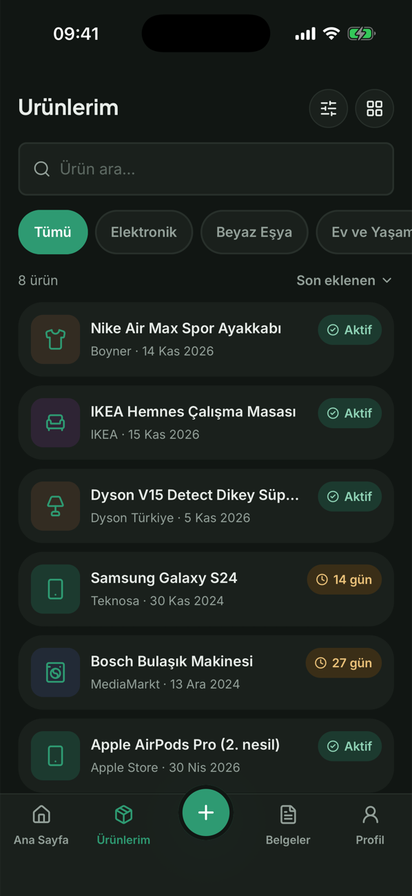 |

> Simülatörde kamera olmadığı için fiş tarama ekranı izin ve galeri seçeneğiyle görünüyor. Gerçek cihazda kamera önizlemesi ve tarama çerçevesi açılıyor.

## Kullandığım teknolojiler

Kullandığım bütün paketler açık kaynak ve ücretsiz. Ücretli bir servis, hazır tema ya da ücretli bir kütüphane kullanmadım.

| Alan | Teknoloji |
| --- | --- |
| Temel | React Native 0.88, React 19, Expo SDK 58, TypeScript 6 |
| Sayfa geçişleri | Expo Router (dosya tabanlı sayfalar, tip güvenli bağlantılar, oturuma göre korunan sayfalar) |
| Arayüz | NativeWind 4 (Tailwind CSS 3), Lucide React Native simgeleri, React Native Reanimated, React Native Gesture Handler |
| Durum yönetimi | Zustand (arayüz ve oturum durumu), TanStack Query 5 (veri çekme, önbellek, güncelleme) |
| Formlar | React Hook Form, Zod |
| Cihazda saklama | AsyncStorage (kayıtlar), Expo SecureStore (oturum), Expo File System (belgeler ve görseller) |
| Cihaz özellikleri | Expo Camera, Expo Image Picker, Expo Document Picker, Expo Image Manipulator, Expo Notifications, Expo Sharing |
| Yazı tipleri | Plus Jakarta Sans (başlıklar), Inter (metinler) |
| Test | Jest, jest-expo, React Native Testing Library |

## Veri katmanı

Şimdilik bir sunucu ya da veritabanı kullanmıyorum. Gerçek bir arka uç yerine, onunla aynı şekilde çalışan **sahte veri katmanı** kurdum:

- Her özelliğin kendi servis ve depo dosyası var (`productService`, `documentService`, `serviceRecordService` gibi). Veriler her kullanıcıya özel anahtarlarla telefonun içinde saklanıyor.
- Ekranlar veriye yalnızca TanStack Query üzerinden ulaşıyor. İleride gerçek bir arka uca geçtiğimde sadece servis dosyalarını değiştirmem yetecek, ekranlara dokunmayacağım.
- **Örnek veriler:** Giriş ekranındaki *Örnek verilerle keşfet* bağlantısı, Türkçe sahte verilerle dolu bir hesap açıyor: 8 ürün, 4 belge ve 3 servis kaydı. Uygulamayı hemen denemek için bunu kullanabilirsiniz.

## Mimari

### Özelliklere göre bölünmüş yapı

Her özelliği kendi klasöründe tuttum ve bileşen, hook, servis, şema, durum ve tip dosyalarını ayrı klasörlere ayırdım. Sayfa dosyaları (`src/app`) sadece bunları bir araya getiriyor.

- **İş kurallarını servislere ayırdım ve test ettim:** garanti hesabı, iade hesabı, ana sayfa özeti, bildirim planı, bildirim kutusu ve ürün süzme kuralları.
- **Sorgu anahtarlarını tek yerde topladım:** `src/shared/lib/query-keys.ts`. Bir kayıt değiştiğinde ilgili listeler kendiliğinden yenileniyor; bildirim tercihleri anında güncelleniyor.
- **Bağlı kayıtları birlikte siliyorum:** Bir ürünü sildiğimde planlı bildirimleri iptal ediyor; hatırlatmaları, servis kayıtlarını, belgeleri ve dosyaları da siliyorum.
- **Hataları tek noktadan yönetiyorum:** Servisler Türkçe mesajlı hatalar üretiyor; ekranlar bunları hata görünümü ve bildirim balonu ile gösteriyor.
- **Tüm metinler tek dosyada:** Kullanıcının gördüğü her metin `src/shared/i18n/tr.ts` dosyasında duruyor.

### Tasarım sistemi

Renkleri, yazı tiplerini, boşlukları ve köşe yuvarlaklıklarını kendi tasarım dosyalarımdan aldım. Renkler açık ve koyu tema için `src/shared/theme/palette.js` dosyasında tanımlı. Ortak bileşenler `src/shared/components/ui` klasöründe: buton, metin alanı, rozet, filtre çipi, kart, anahtar, sekmeli seçim, tarih alanı, alt sayfa, boş durum, liste satırı ve diğerleri.

### Erişilebilirlik

Dokunma alanlarını yeterince büyük tuttum, durumları her zaman simge ve yazıyla birlikte gösterdim, buton ve form alanlarına ekran okuyucu etiketleri ekledim. Yazılar, telefonun yazı boyutu ayarına göre büyüyebiliyor.

## Klasör yapısı

```
keeply/
├── assets/
│   ├── images/              uygulama simgesi ve açılış görseli
│   └── screenshots/         README ekran görüntüleri
├── scripts/
│   └── verify-privacy.sh    tasarım dosyalarımın depoya girmediğini kontrol eder
└── src/
    ├── app/                 sayfalar
    │   ├── (auth)/          hoş geldin, özellikler, giriş, kayıt, şifre sıfırlama
    │   ├── (tabs)/          ana sayfa, ürünlerim, belgeler, profil
    │   ├── products/        ürün ekleme, detay, düzenleme, servis geçmişi
    │   ├── documents/       belge kaydetme ve detay
    │   ├── notifications/   bildirimler ve bildirim tercihleri
    │   ├── profile/         hesap, şifre, dil, gizlilik, yardım, hakkında
    │   ├── reminders/       hatırlatma oluşturma
    │   ├── scanner.tsx      fiş tarama
    │   ├── warranties.tsx   garantiler
    │   └── returns.tsx      iade süreleri
    ├── features/
    │   ├── activity/        son hareketler
    │   ├── auth/            hesap, oturum, form şemaları
    │   ├── dashboard/       ana sayfa özeti ve hızlı işlemler
    │   ├── demo/            örnek verili hesap
    │   ├── documents/       belge servisi, süzme, görüntüleme
    │   ├── notifications/   bildirim planı, tercihler, hatırlatmalar
    │   ├── products/        ürün servisi, form şeması, süzme
    │   ├── profile/         verileri dışa aktarma ve silme
    │   ├── receipt-scanner/ fiş tarama yardımcıları
    │   ├── returns/         iade hesapları
    │   ├── service-history/ servis kayıtları
    │   └── warranties/      garanti hesapları
    ├── providers/           uygulamayı saran sağlayıcılar
    ├── config/              ortam değişkenleri
    └── shared/
        ├── components/      ortak arayüz, form ve yerleşim bileşenleri
        ├── hooks/           ortak hook'lar
        ├── i18n/            Türkçe metinler
        ├── lib/             saklama, hata yönetimi, sorgu ayarları
        ├── services/        dosya saklama ve görsel/dosya seçici
        ├── theme/           renkler ve tema
        └── utils/           tarih, para ve arama yardımcıları
```

## Kurulum

Gerekenler: Node.js 20 veya üzeri ve npm. Uygulamayı açmak için iOS simülatörü (Xcode), Android emülatörü ya da telefondaki [Expo Go](https://expo.dev/go) uygulaması.

```bash
git clone https://github.com/zeynepbass/keeply.git
cd keeply
npm install
cp .env.example .env
npm start
```

Terminalde açılan menüde `i` tuşuna basınca iOS simülatöründe, `a` tuşuna basınca Android emülatöründe açılıyor. Telefonda denemek için ekrandaki karekodu Expo Go ile okutmak yeterli.

Hemen denemek isterseniz giriş ekranındaki **Örnek verilerle keşfet** bağlantısına dokunun.

## Komutlar

| Komut | Ne yapar |
| --- | --- |
| `npm start` | Geliştirme sunucusunu başlatır |
| `npm run ios` | Uygulamayı iOS simülatöründe açar |
| `npm run android` | Uygulamayı Android emülatöründe açar |
| `npm run typecheck` | TypeScript tip kontrolünü çalıştırır |
| `npm run lint` | Kod kurallarını denetler |
| `npm test` | Testleri çalıştırır |
| `npm run check:privacy` | Tasarım dosyalarımın depoya eklenmediğini kontrol eder |
| `npm run verify` | Tip kontrolü, kod denetimi, testler ve gizlilik kontrolünü birlikte çalıştırır |

## Ortam değişkenleri

`.env.example` dosyasını `.env` olarak kopyalamak yeterli. `.env` dosyaları depoya eklenmiyor.

| Değişken | Varsayılan değer | Açıklama |
| --- | --- | --- |
| `EXPO_PUBLIC_SUPPORT_URL` | `https://github.com/zeynepbass/keeply/issues` | Profil > Bize Ulaşın bağlantısı |
| `EXPO_PUBLIC_ENABLE_DEMO` | `true` | Giriş ekranındaki örnek veri bağlantısını açar ya da kapatır |

Uygulama herhangi bir anahtar ya da gizli bilgi gerektirmiyor.

## İstediğim izinler

| İzin | Neden istiyorum |
| --- | --- |
| Kamera | Fiş, fatura ve ürün fotoğrafı çekmek için |
| Fotoğraflar | Galeriden fiş, fatura ve ürün görseli seçmek için |
| Bildirimler | Garanti, iade ve kişisel hatırlatmaları telefonda planlamak için |

İzinleri sadece ilgili işlem başladığında istiyorum. İzin verilmezse uygulama çalışmaya devam ediyor; ayarlara yönlendiriyor ya da galeriden seçme gibi başka bir yol sunuyor.

## Testler

```bash
npm test
npm test -- --coverage
```

85 testle şu konuları denetliyorum:

- **Tarih hesapları:** ay sonu taşmaları, artık yıllar, yaz saati geçişleri, Türkçe tarih biçimleri.
- **Garanti ve iade hesapları:** bitiş tarihi, 30 günlük eşik, bitiş günü, acil iade dönemi.
- **Form doğrulama:** kayıt, giriş, ürün, servis kaydı ve hatırlatma formları ile Türkçe hata mesajları.
- **Ürün işlemleri:** ekleme, düzenleme, garantinin yeniden hesaplanması, bağlı kayıtlarla silme, kullanıcı verilerinin birbirinden ayrı tutulması.
- **Süzme ve arama:** Türkçe karakterlere duyarsız arama, kategori, garanti durumu ve sıralama.
- **Bildirimler:** planlanan tarihler, eski bildirimlerin yenilenmesi, izin verilmemesi, kapalı tercihler.
- **Hesap:** şifrenin güvenli saklanması, oturum, şifre sıfırlama, profil güncelleme, verileri dışa aktarma ve silme.
- **Arayüz bileşenleri:** buton, metin alanı, seçim kontrolleri ve boş durum ekranı.

## Çalışma düzenim

- Her özelliği `main` dalından açtığım ayrı bir dalda geliştirdim.
- Birleştirmeden önce `npm run verify` ile tip kontrolü, kod denetimi, testler ve gizlilik kontrolünü çalıştırdım.
- Dalları ayrı birleştirme kaydıyla birleştirdim; böylece her özelliğin geçmişi görünür kaldı.
- Commit mesajlarını Türkçe ve tür önekiyle yazdım; örneğin `feat: garanti takip sistemi oluşturuldu`.
- Tasarım dosyalarımı sadece kendi bilgisayarımda tutuyorum. `scripts/verify-privacy.sh` her kayıt ve gönderimden önce bu dosyaların depoya hiç girmediğini kontrol ediyor.

| Dal | İçerik |
| --- | --- |
| `feature/project-setup` | Proje altyapısı, test ve kod denetimi ayarları |
| `feature/design-system` | Tema, yazı tipleri, ortak bileşenler, Türkçe metinler |
| `feature/authentication` | Tanıtım ekranları, kayıt, giriş, şifre sıfırlama, oturum |
| `feature/product-management` | Ürün listesi, ekleme adımları, detay, düzenleme, örnek veriler |
| `feature/dashboard` | Ana sayfa özeti ve son hareketler |
| `feature/receipt-scanner` | Kamerayla fiş tarama |
| `feature/warranty-management` | Garanti listesi ve hesapları |
| `feature/return-deadlines` | İade süreleri |
| `feature/document-management` | Belge kütüphanesi |
| `feature/service-history` | Servis geçmişi |
| `feature/notifications` | Bildirimler ve hatırlatmalar |
| `feature/profile-settings` | Profil ve ayarlar |
| `feature/testing` | Bileşen ve form testleri |
| `feature/documentation` | Proje açıklaması ve ekran görüntüleri |

## Sırada ne var

- [ ] Telefonun içinde çalışan ücretsiz bir yazı tanıma çözümüyle fiş bilgilerini otomatik doldurmak
- [ ] Gerçek bir arka uca geçip verileri cihazlar arasında eşitlemek
- [ ] E-posta ile bildirim göndermek
- [ ] Mağazaya göre hazır iade süreleri eklemek
- [ ] Yaklaşan garantileri gösteren bir ana ekran bileşeni yapmak
- [ ] Başka dil seçenekleri eklemek

## Lisans

Bu proje tescilli bir yazılımdır, tüm hakları saklıdır. Ayrıntılar için [LICENSE](LICENSE) dosyasına bakabilirsiniz.
