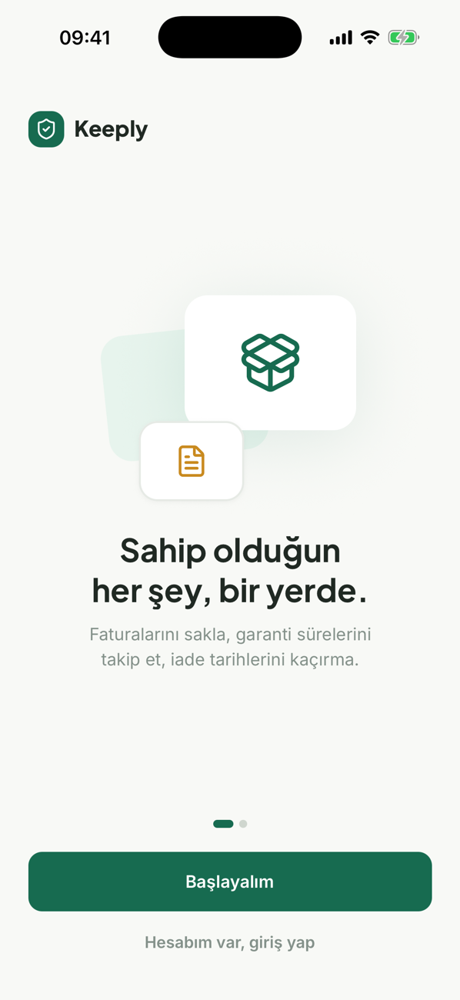
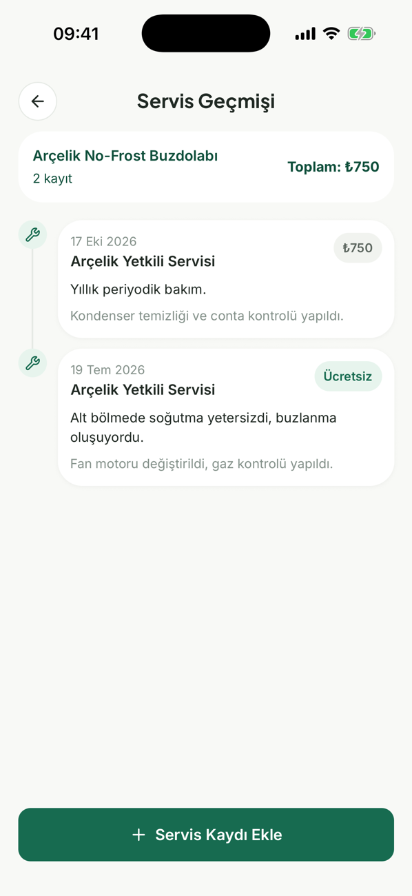
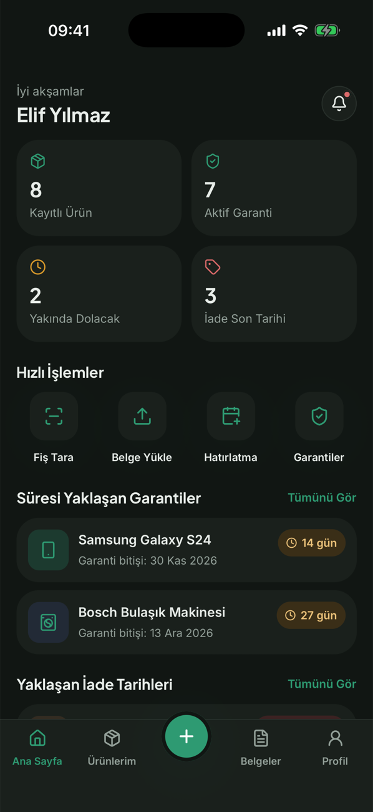

<p align="center">
  
</p>

<h1 align="center">Keeply</h1>

<p align="center"><strong>Satın aldıkların, garantilerin ve belgelerin tek yerde.</strong></p>

<p align="center">
  React Native · Expo · TypeScript · NativeWind
</p>

Keeply; satın aldığın ürünleri kaydetmeni, fiş ve faturalarını dijital olarak saklamanı, garanti sürelerini ve iade son tarihlerini takip etmeni, servis ve tamir geçmişini tutmanı sağlayan kişisel alışveriş asistanıdır. Önemli tarihler yaklaştığında cihazında yerel bildirim gönderir.

<p align="center">
  
  
  
</p>

## İçindekiler

- [Projenin amacı](#projenin-amacı)
- [Özellikler](#özellikler)
- [Ekran görüntüleri](#ekran-görüntüleri)
- [Kullanılan teknolojiler](#kullanılan-teknolojiler)
- [Mimari](#mimari)
- [Proje yapısı](#proje-yapısı)
- [Kurulum](#kurulum)
- [Geliştirme komutları](#geliştirme-komutları)
- [Ortam değişkenleri](#ortam-değişkenleri)
- [Gerekli izinler](#gerekli-izinler)
- [Testler](#testler)
- [Git iş akışı](#git-iş-akışı)
- [Yol haritası](#yol-haritası)
- [Lisans](#lisans)

## Projenin amacı

Fişler kaybolur, garanti belgeleri çekmecede unutulur, iade süresi fark edilmeden dolar. Keeply bu bilgileri tek bir yerde toplar:

- Her ürünün mağazası, fiyatı, garanti süresi ve iade son tarihi kayıtlıdır.
- Garanti bitişi ve iade son tarihi otomatik hesaplanır, yaklaşınca hatırlatılır.
- Fiş, fatura, garanti belgesi ve sözleşmeler ürüne bağlı olarak saklanır.
- Servis ve tamir kayıtları ürünün geçmişinde kronolojik olarak tutulur.

## Özellikler

### Ürün yönetimi
- 6 adımlı ürün ekleme akışı: görsel, ürün bilgisi, satın alma, garanti, fiş/fatura, onay
- Ürün düzenleme, silme (bağlı belgeler, servis kayıtları ve hatırlatmalar da silinir)
- Ürün görseli ekleme (kamera veya galeri)
- Kategoriler: Elektronik, Beyaz Eşya, Ev ve Yaşam, Moda, Kişisel Bakım, Mobilya, Diğer
- Türkçe karakterlere duyarsız arama (`bulasik` yazınca "Bulaşık Makinesi" bulunur)
- Kategori ve garanti durumuna göre filtreleme; son eklenen, ada, fiyata ve garanti bitişine göre sıralama
- Liste ve ızgara görünümü

### Garanti ve iade takibi
- Garanti bitişi takvim ayına göre hesaplanır (31 Ocak + 1 ay → şubatın son günü)
- Durumlar: Aktif, Yakında Dolacak (30 gün ve daha az), Süresi Dolmuş, Garantisiz
- Kalan gün sayısı ve geçen süre göstergesi
- İade son tarihi varsayılan olarak satın almadan 14 gün sonra; son 3 gün "acil" olarak işaretlenir
- Tarih hesapları gün bazında yapılır, yaz saati ve saat dilimi geçişlerinden etkilenmez

### Fiş tarama ve belgeler
- Kamera ile fiş çekme, önizleme, döndürme, tekrar çekme ve galeriden seçme
- Kamera izni reddedildiğinde ayarlara yönlendirme ve galeri seçeneği
- PDF, JPG ve PNG belgeler (en fazla 10 MB); fiş, fatura, garanti belgesi, sözleşme türleri
- Belge kütüphanesi: arama, türe göre filtreleme, önizleme, paylaşma, silme
- Belgeleri ürüne bağlama
- Otomatik metin tanıma (OCR) henüz yok; arayüzde "Yakında" olarak gösterilir, sahte sonuç üretilmez

### Servis geçmişi
- Servis tarihi, servis sağlayıcı, sorun, yapılan işlem, ücret, notlar ve servis belgeleri
- Ürün başına kronolojik zaman çizelgesi ve toplam servis ücreti

### Bildirimler ve hatırlatmalar
- Garanti bitişinden 7, 14 veya 30 gün önce (seçilebilir) ve bitiş günü yerel bildirim
- İade son tarihinden 3 gün ve 1 gün önce yerel bildirim
- Kullanıcının oluşturduğu tarihli hatırlatmalar
- Bildirim kutusu: Bugün, Bu Hafta, Daha Önce grupları; okundu işaretleme
- İzin reddedildiğinde bildirim planlandı denmez, kullanıcıya gerçek sonuç gösterilir

### Ana sayfa
- Kişisel selamlama, kayıtlı ürün, aktif garanti, yakında dolacak garanti ve açık iade sayıları
- Hızlı işlemler: Fiş Tara, Belge Yükle, Hatırlatma, Garantiler
- Süresi yaklaşan garantiler, yaklaşan iade tarihleri, son eklenen ürünler ve son hareketler

### Hesap ve ayarlar
- Kayıt, giriş, şifre sıfırlama, oturumun cihazda güvenli saklanması, çıkış
- Hesap bilgileri ve şifre değiştirme
- Açık, koyu ve sistem teması
- Bildirim tercihleri, gizlilik ayarları, tüm verileri silme, hesabı silme
- Verileri JSON dosyası olarak dışa aktarma
- Yardım merkezi, destek bağlantısı ve hakkında sayfası

## Ekran görüntüleri

Görüntüler, iOS simülatöründe çalışan uygulamadan demo hesabıyla alınmıştır.

| Hoş geldin | Keeply ile neler yapılır | Giriş |
| --- | --- | --- |
|  |  |  |

| Ana sayfa | Ürünlerim | Ürün detayı |
| --- | --- | --- |
|  |  |  |

| Ürün ekleme | Fiş tarama | Garantiler |
| --- | --- | --- |
|  |  |  |

| İade süreleri | Belgeler | Servis geçmişi |
| --- | --- | --- |
|  |  |  |

| Bildirimler | Bildirim tercihleri | Profil |
| --- | --- | --- |
|  |  |  |

| Koyu tema: Ana sayfa | Koyu tema: Ürünlerim |
| --- | --- |
|  |  |

> Simülatörde kamera bulunmadığı için fiş tarama ekranı izin/galeri durumunda görünüyor. Gerçek cihazda kamera önizlemesi ve tarama çerçevesi açılır.

## Kullanılan teknolojiler

Bütün paketler açık kaynak ve ücretsizdir; ücretli bir servis, SDK veya hazır şablon kullanılmaz.

| Katman | Teknoloji |
| --- | --- |
| Temel | React Native 0.88, React 19, Expo SDK 58, TypeScript 6 |
| Navigasyon | Expo Router (dosya tabanlı rotalar, typed routes, korumalı rotalar) |
| Arayüz | NativeWind 4 (Tailwind CSS 3), Lucide React Native, React Native Reanimated, React Native Gesture Handler |
| Durum yönetimi | Zustand (arayüz ve oturum durumu), TanStack Query 5 (veri, önbellek, mutation) |
| Formlar | React Hook Form, Zod |
| Depolama | AsyncStorage (kayıtlar), Expo SecureStore (oturum), Expo File System (belge ve görseller) |
| Cihaz özellikleri | Expo Camera, Expo Image Picker, Expo Document Picker, Expo Image Manipulator, Expo Notifications, Expo Sharing |
| Yazı tipleri | Plus Jakarta Sans (başlıklar), Inter (metin) |
| Test | Jest, jest-expo, React Native Testing Library |

### Veri katmanı hakkında

Uygulama şimdilik bir sunucuya veya veritabanı servisine bağlanmaz. Supabase gibi bir servis yerine, aynı arayüzü sunan **cihaz içi mock API katmanı** kullanılır:

- Her özelliğin bir `service` ve `repository` dosyası vardır (`productService`, `documentService`, `serviceRecordService` ...). Bu katman veriyi kullanıcıya özel anahtarlarla AsyncStorage'da tutar.
- Ekranlar veriye yalnızca TanStack Query hook'ları üzerinden erişir; bu sayede ileride gerçek bir API'ye geçmek için yalnızca servis katmanını değiştirmek yeterli olur.
- **Demo hesabı** gerçekçi Türkçe sahte verilerle (8 ürün, 4 belge, 3 servis kaydı) gelir. Giriş ekranındaki *Örnek verilerle keşfet* bağlantısı bu hesabı oluşturur.

## Mimari

### Özellik tabanlı yapı

Her özellik kendi klasöründe `components`, `hooks`, `services`, `schemas`, `stores` ve `types` alt klasörlerine ayrılır. Ekran dosyaları (`src/app`) yalnızca hook'ları ve bileşenleri bir araya getirir.

- **Saf iş mantığı servislerde ve testlidir:** garanti hesabı (`warranty-calculator`), iade hesabı (`return-calculator`), ana sayfa özeti (`dashboard-summary`), bildirim planı (`reminder-planner`), bildirim kutusu (`inbox-builder`), ürün filtreleri (`product-filters`).
- **Tek veri kaynağı:** Bütün sorgu anahtarları `src/shared/lib/query-keys.ts` içindedir. Mutation'lar ilgili anahtarları geçersiz kılar; bildirim tercihleri iyimser güncelleme kullanır.
- **Bağımlı kayıtların silinmesi:** Ürün silindiğinde `product-dependents.ts` listesindeki adımlar sırayla çalışır: planlı bildirimler iptal edilir, hatırlatmalar, servis kayıtları, belgeler ve dosyalar silinir.
- **Merkezi hata yönetimi:** Servisler Türkçe mesajlı `AppError` fırlatır; ekranlar `ErrorState` ve bildirim (toast) ile gösterir.
- **Merkezi yerelleştirme:** Kullanıcıya görünen bütün metinler `src/shared/i18n/tr.ts` dosyasındadır.

### Tasarım sistemi

Renk, yazı tipi, boşluk ve köşe değerleri tasarım dosyasından alınmıştır. Renkler `src/shared/theme/palette.js` içinde açık ve koyu tema için tanımlanır, NativeWind'e CSS değişkeni olarak aktarılır. Ortak bileşenler `src/shared/components/ui` altındadır: `Button`, `TextField`, `Badge`, `Chip`, `Card`, `Switch`, `SegmentedControl`, `DateField`, `Sheet`, `EmptyState`, `ListRow` ve diğerleri.

### Erişilebilirlik

Dokunma hedefleri en az 44 pt, durumlar her zaman ikon ve metinle birlikte gösterilir, butonlar ve form alanları ekran okuyucu etiketleri taşır, metinler sistem yazı boyutuna (en fazla 1.4×) uyum sağlar.

## Proje yapısı

```
keeply/
├── assets/
│   ├── images/              uygulama ikonu ve açılış görseli
│   └── screenshots/         README ekran görüntüleri
├── scripts/
│   └── verify-privacy.sh    tasarım klasörünün depoya girmediğini doğrular
└── src/
    ├── app/                 Expo Router ekranları
    │   ├── (auth)/          hoş geldin, özellikler, giriş, kayıt, şifre sıfırlama
    │   ├── (tabs)/          ana sayfa, ürünlerim, belgeler, profil
    │   ├── products/        ürün ekleme, detay, düzenleme, servis geçmişi
    │   ├── documents/       belge kaydetme ve detay
    │   ├── notifications/   bildirim kutusu ve tercihler
    │   ├── profile/         hesap, şifre, dil, gizlilik, yardım, hakkında
    │   ├── reminders/       hatırlatma oluşturma
    │   ├── scanner.tsx      fiş tarama
    │   ├── warranties.tsx   garantiler
    │   └── returns.tsx      iade süreleri
    ├── features/
    │   ├── activity/        son hareketler
    │   ├── auth/            hesap, oturum, şemalar
    │   ├── dashboard/       özet ve hızlı işlemler
    │   ├── demo/            demo hesabı ve örnek veriler
    │   ├── documents/       belge servisi, filtreler, görüntüleyici
    │   ├── notifications/   planlayıcı, zamanlayıcı, tercihler, hatırlatmalar
    │   ├── products/        ürün servisi, form şeması, filtreler
    │   ├── profile/         veri dışa aktarma ve silme
    │   ├── receipt-scanner/ tarama yardımcıları
    │   ├── returns/         iade hesapları
    │   ├── service-history/ servis kayıtları
    │   └── warranties/      garanti hesapları
    ├── providers/           uygulama sağlayıcıları
    ├── config/              ortam değişkenleri
    └── shared/
        ├── components/      ui, form, layout ve bildirim bileşenleri
        ├── hooks/           ortak hook'lar
        ├── i18n/            Türkçe metin kataloğu
        ├── lib/             depolama, hata, sorgu istemcisi ve anahtarları
        ├── services/        dosya depolama ve medya seçici
        ├── theme/           renk paleti ve tema sağlayıcı
        └── utils/           tarih, para birimi ve arama yardımcıları
```

## Kurulum

Gereksinimler: Node.js 20 veya üzeri, npm. Uygulamayı çalıştırmak için iOS simülatörü (Xcode), Android emülatörü veya telefonda [Expo Go](https://expo.dev/go).

```bash
git clone https://github.com/zeynepbass/keeply.git
cd keeply
npm install
cp .env.example .env
npm start
```

Terminalde açılan menüden `i` (iOS simülatörü) veya `a` (Android emülatörü) seçilir ya da QR kod Expo Go ile okutulur.

Hemen denemek için giriş ekranında **Örnek verilerle keşfet** bağlantısına dokun. Demo hesabı örnek ürün, belge ve servis kayıtlarıyla açılır.

## Geliştirme komutları

| Komut | Açıklama |
| --- | --- |
| `npm start` | Expo geliştirme sunucusunu başlatır |
| `npm run ios` | Uygulamayı iOS simülatöründe açar |
| `npm run android` | Uygulamayı Android emülatöründe açar |
| `npm run typecheck` | TypeScript tip kontrolü |
| `npm run lint` | ESLint (console ve uyarı yorumları yasak) |
| `npm test` | Jest testleri |
| `npm run check:privacy` | Tasarım klasörünün depoya eklenmediğini doğrular |
| `npm run verify` | Tip kontrolü, lint, testler ve gizlilik kontrolünü birlikte çalıştırır |

## Ortam değişkenleri

`.env.example` dosyası `.env` olarak kopyalanır. `.env` dosyaları depoya eklenmez.

| Değişken | Varsayılan | Açıklama |
| --- | --- | --- |
| `EXPO_PUBLIC_SUPPORT_URL` | `https://github.com/zeynepbass/keeply/issues` | Profil > Bize Ulaşın bağlantısı |
| `EXPO_PUBLIC_ENABLE_DEMO` | `true` | Giriş ekranındaki demo hesabı bağlantısını açar veya kapatır |

Uygulama bir API anahtarı veya gizli bilgi gerektirmez.

## Gerekli izinler

| İzin | Ne için kullanılır |
| --- | --- |
| Kamera | Fiş, fatura ve ürün fotoğrafı çekmek |
| Fotoğraflar | Galeriden fiş, fatura ve ürün görseli seçmek |
| Bildirimler | Garanti, iade ve kullanıcı hatırlatmalarını cihazda planlamak |

İzinler yalnızca ilgili işlem başlatıldığında istenir. Reddedilirse uygulama çalışmaya devam eder; kullanıcı ayarlara yönlendirilir veya alternatif (galeriden seçme) sunulur.

## Testler

```bash
npm test
npm test -- --coverage
```

85 test şu alanları kapsar:

- **Tarih yardımcıları:** ay sonu taşmaları, artık yıl, yaz saati geçişleri, Türkçe tarih biçimleri
- **Garanti ve iade hesapları:** bitiş tarihi, 30 günlük eşik, bitiş günü, acil iade dönemi
- **Form doğrulama:** kayıt, giriş, ürün, servis kaydı ve hatırlatma şemaları (Türkçe hata mesajları)
- **Ürün servisi:** ekleme, düzenleme, garanti yeniden hesaplama, bağlı kayıtlarla silme, kullanıcı izolasyonu
- **Filtreler:** Türkçe karakter duyarsız arama, kategori, garanti durumu ve sıralama
- **Bildirimler:** planlanan tarihler, eski bildirimlerin değiştirilmesi, izin reddi, kapalı tercih
- **Hesap:** şifre hash'leme, oturum, şifre sıfırlama, profil güncelleme, veri dışa aktarma ve silme
- **Arayüz bileşenleri:** buton, form alanı, seçim kontrolleri ve boş durum

## Git iş akışı

- Her özellik `main` dalından açılan ayrı bir `feature/*` dalında geliştirilir.
- Birleştirmeden önce `npm run verify` çalıştırılır: tip kontrolü, lint, testler ve gizlilik kontrolü.
- Dallar `--no-ff` ile birleştirilir; özellik commit'leri korunur.
- Commit mesajları Türkçe ve [Conventional Commits](https://www.conventionalcommits.org/) biçimindedir: `feat: garanti takip sistemi oluşturuldu`.
- Yerel tasarım kaynakları `design/` klasöründe tutulur ve hiçbir zaman depoya eklenmez. `scripts/verify-privacy.sh` bunu commit ve push öncesinde git geçmişinin tamamında doğrular.

| Dal | İçerik |
| --- | --- |
| `feature/project-setup` | Expo, TypeScript, NativeWind, test ve lint altyapısı |
| `feature/design-system` | Tema, yazı tipleri, ortak bileşenler, Türkçe metin kataloğu |
| `feature/authentication` | Onboarding, kayıt, giriş, şifre sıfırlama, oturum |
| `feature/product-management` | Ürün listesi, ekleme akışı, detay, düzenleme, demo hesabı |
| `feature/dashboard` | Ana sayfa özeti ve son hareketler |
| `feature/receipt-scanner` | Kamera ile fiş tarama |
| `feature/warranty-management` | Garanti listesi ve hesapları |
| `feature/return-deadlines` | İade süreleri |
| `feature/document-management` | Belge kütüphanesi |
| `feature/service-history` | Servis geçmişi |
| `feature/notifications` | Bildirimler ve hatırlatmalar |
| `feature/profile-settings` | Profil ve ayarlar |
| `feature/testing` | Bileşen ve form testleri |
| `feature/documentation` | README ve ekran görüntüleri |

## Yol haritası

- [ ] Ücretsiz, cihaz içinde çalışan OCR ile fiş bilgilerini otomatik doldurma
- [ ] Gerçek bir API'ye geçiş (servis katmanı aynı kalacak şekilde) ve cihazlar arası senkronizasyon
- [ ] E-posta ile bildirim
- [ ] Ürün başına özel iade süresi şablonları (mağazaya göre)
- [ ] Ana ekran widget'ı ile yaklaşan garantiler
- [ ] Ek dil desteği

## Lisans

Tescilli yazılım, tüm hakları saklıdır. Ayrıntılar için [LICENSE](LICENSE).
